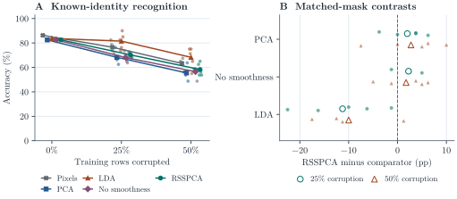

# Robust sparse smooth PCA for face recognition

CISC3024 Pattern Recognition · AI Assignment #3 · November 2026

The primary study adapts Wang et al.'s 2025 RSSPCA to closed-set recognition of 40 known identities in Olivetti. The original writer-disjoint UCI Optdigits study is preserved as a secondary transfer experiment. [RSSPCA paper](https://doi.org/10.1371/journal.pone.0323281) · [AT&T Laboratories Cambridge face database](https://www.cl.cam.ac.uk/research/dtg/attarchive/facedatabase.html)

| Training corruption | RSSPCA · 16 | PCA · 16 | LDA · 16 | No smoothing · 16 | Pixels · 256 |
| --- | ---: | ---: | ---: | ---: | ---: |
| Clean | 82.50% | 82.50% | 83.75% | 82.50% | 86.25% |
| 25% | 70.25% | 68.25% | 81.50% | 68.00% | 76.50% |
| 50% | 58.25% | 55.50% | 68.25% | 56.50% | 63.25% |

The corrupted scores are means across five paired training masks on one fixed set of 80 clean test views. At 50% corruption, RSSPCA's matched reconstruction MSE was 24.5% below PCA at 16 coordinates. This measures projecting clean inputs with a subspace fitted under training corruption.



## Primary report and evidence

- [Face-primary PDF](report/report.pdf) and [LaTeX entry point](report/report.tex)
- [Human-directed face pivot and provenance](docs/face_pivot_decision.md), [locked face design](docs/face_study_design.md), and [training-only gate output](results/faces/gate.json)
- [Selected parameters](results/faces/selection.json), [freeze](results/faces/freeze.json), [per-run results](results/faces/final.json), [replay](results/faces/replay.txt) and [face figures](results/faces/figures)
- [Original method search](docs/research.md), [Prompt 01 selection gate](docs/algorithm_selection.md), [Optdigits report archive](report/optdigits/README.md) and [digit results](results/summary.json)
- [Documentation pages](docs/wiki/Home.md)
- [Prompt 02 quality review](docs/quality_review.md) and [independent face checks](results/faces/prompt02_audit.json)

The public edition includes the student's reflection, frozen evidence and figures from saved masks, learned loadings and errors. It credits AT&T Laboratories Cambridge and obtains source portraits separately. [Data access and attribution](data/README.md)

## Reproduce the face study

Run from the project root. Use Python 3.14.3 for the observed environment and install the pinned packages.

```text
python -m pip install -r requirements.txt
python -m src.face_study fetch
python -m scripts.face_gate
```

For a full replay, use a new output directory, replacing the example path if it already exists. The first two study stages use development rows and write the frozen fit before final scoring.

```text
python -m src.face_study tune --out results/reproduction/face-replay
python -m src.face_study prepare --out results/reproduction/face-replay
python -m src.face_study final --out results/reproduction/face-replay
python -m src.face_study audit --out results/reproduction/face-replay --against results/faces
python -m scripts.review_face
python -m src.face_summary
python -m src.face_figures
```

The replay compares selection, masks, loadings and outputs element for element. Timing varies. `scripts.review_face` independently decodes the pinned source, regenerates both mask streams, computes the saved 3-NN predictions directly, checks least-squares reconstruction, and evaluates the recorded RSSPCA stopping behavior. It reads the canonical archives and writes only `results/faces/prompt02_audit.json`. `src.face_summary` and `src.face_figures` read the canonical archived run by default.

Use `python -m src.face_figures --local-image-galleries` to additionally regenerate the portrait-based illustrations into the ignored `results/faces/local-image-galleries/` directory from the locally downloaded data. The standard figure command needs only the archived numeric outputs.

On the audited Windows environment, loading scikit-learn before pytest avoids the OpenMP initialization error encountered by the plain launcher.

```powershell
$env:LOKY_MAX_CPU_COUNT = '1'
$env:PYTEST_DISABLE_PLUGIN_AUTOLOAD = '1'
python -c "import sklearn, pytest; raise SystemExit(pytest.main(['-q']))"
```

## Build the report

From inside `report/`, use bundled Tectonic or XeLaTeX with BibTeX. The report and figure generators load the included [Latin Modern OpenType fonts](report/fonts/README.md).

```text
tectonic -X compile --untrusted report.tex
latexmk -xelatex -interaction=nonstopmode -halt-on-error report.tex
```

To replay the digit study, use the commands in the [Optdigits archive](report/optdigits/README.md). The fit code and original digit results retain their established paths so the original manifest remains verifiable.
