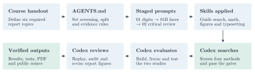

# AI workflow

The handout defined the recent-method assignment and six report topics. `AGENTS.md` recorded the algorithm eligibility, experimental and evidence rules. The staged prompts, primary sources and actual execution records provide the trace from instructions to results.

| Stage | What happened |
| --- | --- |
| Prompt 01 | Codex searched primary papers, compared four candidates, passed the development-only gate and implemented and replayed the supplementary Optdigits experiment. |
| Prompt 01B | The student requested faces as the primary application. Codex kept RSSPCA and the original digit evidence, tested face feasibility and froze a separate closed-set face protocol before scoring. |
| Prompt 02 | Codex checked the equations, reproduced results, audited graphics, corrected two prose figures and added stopping diagnostics using the archived traces. |
| Reflection | The student supplied the first-person reflection. Codex inserted it into the report with LaTeX formatting. |
| Prompt 03 | Codex prepared the public source, figure and report edition with documentation and a reproducible local path for portrait-based illustrations. |

Skills guided literature screening, mathematical auditing, experimental design, figure checks, LaTeX compilation and PDF inspection. The reflection belongs to the student. [Persistent instructions](../../AGENTS.md) · [Prompt directory](../../prompts/) · [AI-use log](../ai_usage.md) · [Review record](../quality_review.md)
