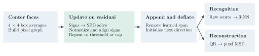

# Algorithm and mathematics

Let $X$ contain the $n$ centered training rows and let $R$ be the current residual in $d$ pixel coordinates. Classical PCA extracts orthonormal directions from $S=X^\top X/(n-1)$. Stationarity of $w^\top Sw$ under $w^\top w=1$ gives $Sw=\lambda w$. The rank is at most $\min(d,n-1)$.

Fisher LDA uses labels for its within-class scatter $S_W$ and between-class scatter $S_B$. The generalized eigenproblem is $S_Bw=\lambda S_Ww$ when $S_W$ is invertible. The SVD implementation whitens supported within-class coordinates before extracting directions of class-mean separation. There are at most $C-1$ discriminant directions, or 39 with 40 known identities. At the 240-row tuning fit, the within-class rank is at most $240-40=200$. [Report derivation](../../report/algorithm.tex)

## Graph-regularized absolute-score update

RSSPCA maximizes $\lVert Rw\rVert_1$ with unit norm and budgets for loading magnitude and graph energy. Its absolute projected scores grow linearly with amplitude. The graph joins horizontal and vertical pixel neighbors. For undirected edges $\mathcal E$, the Laplacian satisfies

$$
w^\top Lw=\sum_{\{p,q\}\in\mathcal E}(w_p-w_q)^2.
$$

There are 480 edges in the $16\times16$ face grid. At the current unit direction $w$, use $D=\operatorname{diag}(|w|)$, $H=D^{1/2}$ and $v=R^\top\operatorname{sign}(Rw)$. The linear sign bound and the local quadratic bound on the loading magnitudes give the published update direction. The implementation solves the equivalent symmetric system

$$
(D+\eta I+\gamma HLH)t=Hv,\qquad p=Ht,\qquad w^+=p/\lVert p\rVert_2.
$$

The system is positive definite for $\eta>0$ and $\gamma\ge0$. Multiplication by $H$ preserves exact zeros in the output. The code uses fixed penalty ratios and a sign-invariant step stop at $10^{-4}$, with a 100-update cap. The step stop measures finite-iteration behavior. The report includes an exact two-pixel solve and a counterexample to treating the normalized update as an exact sphere-constrained optimizer. [Primary method](https://doi.org/10.1371/journal.pone.0323281) · [Projection code](../../src/projectors.py)

Existing loading columns span an orthonormal basis $Q$. Fit the next direction from the deflated residual $R=X-XQQ^\top$. Recognition uses raw scores $W^\top(a-\mu)$ with shared Euclidean 3-NN, while reconstruction uses orthogonal projection $\widehat a=\mu+QQ^\top(a-\mu)$ onto the same span. The least-squares pixel error is equivalent to using a thin QR basis of $W$.

