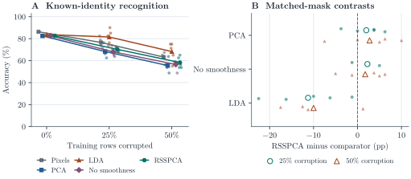
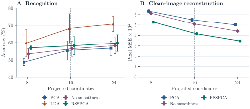

# Experiments and results

Recognition accuracy is computed on the same 80 clean views under each training condition. Entries at positive severity are mean ± sample SD in percentage points across five masks.

| Method | Coordinates | Clean | 25% training corruption | 50% training corruption |
| --- | ---: | ---: | ---: | ---: |
| Raw pixels | 256 | 86.25 | 76.50 ± 4.37 | 63.25 ± 4.20 |
| PCA | 16 | 82.50 | 68.25 ± 5.05 | 55.50 ± 5.42 |
| Fisher LDA | 16 | 83.75 | 81.50 ± 6.58 | 68.25 ± 8.46 |
| No smoothness | 16 | 82.50 | 68.00 ± 4.01 | 56.50 ± 4.37 |
| RSSPCA | 16 | 82.50 | 70.25 ± 2.24 | 58.25 ± 5.20 |

Graph smoothing reduced mean loading energy from 2.440 to 1.226 at 50% training corruption. RSSPCA's advantage over matched PCA at that severity ranged from −7.50 to +10.00 percentage points across masks. Fisher LDA achieved the higher mean among the 16-coordinate methods. RSSPCA lowered the clean-input reconstruction MSE from 5.513 to 4.162 on the scale of pixel MSE multiplied by $10^3$. Clean-training PCA had lower reconstruction error. [Per-fit data](../../results/faces/final.json) · [Independent audit](../../results/faces/prompt02_audit.json)

The repeated masks estimate sensitivity on the fixed split. They do not sample new identities. Perturbations change both how the subspace is estimated and which training vectors vote. The tests use clean views of known people.

## Supplementary digits

Optdigits precedes the face pivot, uses different writers in the official holdout and has its own tuning and freeze. At eight coordinates and 50% training corruption, RSSPCA reached 90.76% versus 91.13% for PCA. The face and digit results should be read under their own protocols. [Optdigits report and replay](../../report/optdigits/README.md)
