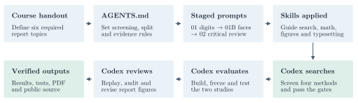

# RSSPCA for closed-set face recognition

CISC3024 Pattern Recognition, AI Assignment #3. The primary experiment applies robust sparse smooth PCA (RSSPCA) to 40 known identities in Olivetti. It evaluates identification and clean-image reconstruction after synthetic corruption of training faces. The original writer-disjoint Optdigits experiment is preserved as supplementary evidence.

- [Algorithm and mathematics](Algorithm-and-Mathematics.md)
- [Literature and selection](Literature-and-Selection.md)
- [Dataset and protocol](Dataset-and-Protocol.md)
- [Experiments and results](Experiments-and-Results.md)
- [Figures and visualization](Figures-and-Visualization.md)
- [Reproduction](Reproduction.md)
- [AI workflow](AI-Workflow.md)

The repository provides the complete report, source, tests and frozen evidence. [Repository README](../../README.md) · [Final PDF](../../report/report.pdf)
